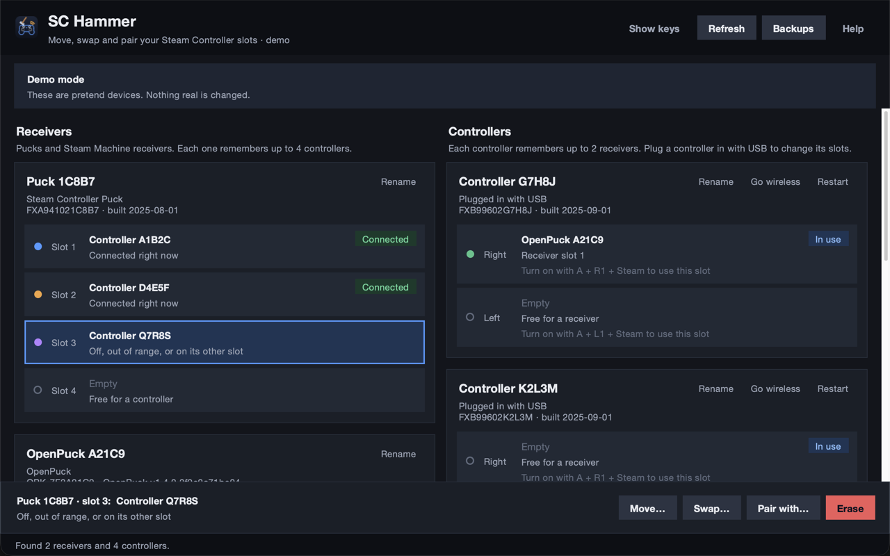

# SC Hammer

**Move, swap and pair your Steam Controller slots.** See and rearrange which Steam Controllers are paired with
which receivers, without Steam.

*Not a Hammer editor tool. U Can't Map This.*



It works with:

- **Steam Controllers**, wireless or plugged in with USB
- **Steam Controller Pucks** (the USB receiver for the Steam Controller 2)
- the receiver built into a **Steam Machine**
- **[OpenPuck](https://github.com/safijari/openpuck)** receivers in Steam mode

Any number of receivers and controllers can be connected at once.

## What you can do

A receiver remembers up to **4 controllers** (slots 1–4), and a controller remembers up to **2 receivers**
(its **right** and **left** slots, as Steam calls them; turning it on with **A + R1 + Steam** uses the right slot,
**A + L1 + Steam** the left). Click a slot, then:

| Action | What it does |
|---|---|
| **Move** | Put a pairing into an empty slot. Within one receiver or controller nothing changes but the slot. Onto another receiver or controller, it pairs afresh with the other side of the pairing (which must be plugged in; a controller must be on USB) and clears the slot it came from. |
| **Swap** | Trade two slots on the same receiver, or a controller's two slots. |
| **Pair** | Make a brand new pairing between a receiver slot and a controller plugged in with USB. The controller slot's old pairing is removed from both sides. |
| **Erase** | Forget a pairing, on both sides where they're connected. |

Each pairing lives in exactly one receiver slot and one controller slot, and every slot's label names the real
device on the other side. Nothing is ever shared or copied, so a controller never connects to two receivers
through one slot. Pairings that were copied with other tools are tagged **Duplicate**; erase one, or pair
again, to clean them up.

You can also drag a slot onto another slot, or right-click it. Matching coloured dots show which receiver slot
and controller slot belong together. Every change asks for confirmation in plain words first, and **a backup of
every slot is saved before each change**, so **Backups → Restore** can undo it.

You can give receivers and controllers names ("Living room", "Sam's controller") with **Rename**. Names are only
stored on your computer.

## Download and run

1. Download `SC-Hammer-…-x86_64.AppImage` from the
   [Releases](../../releases) page.
2. Make it executable: right-click it → **Properties** → **Permissions** → **Is executable**, or in a
   terminal:
   ```bash
   chmod +x SC-Hammer-*-x86_64.AppImage
   ```
3. Double-click it.

No installation and no `sudo` are needed. Everything (Python and Tk) is inside the AppImage.

### Steam Deck / SteamOS

Run it from **Desktop Mode**. To use it from Game Mode, add the AppImage as a non-Steam game (Steam →
**Games** → **Add a Non-Steam Game to My Library**) and use the trackpad as a mouse.

### Try it without hardware

```bash
./SC-Hammer-*-x86_64.AppImage --demo
```

This shows two pretend receivers and four pretend controllers. Nothing real is changed.

## Permissions

The app talks to the devices through `/dev/hidraw*`. On SteamOS, and on any desktop where Steam is installed,
the logged-in user is normally allowed to open Valve devices, because Steam's device rules (the
`steam-devices` package) give the active user access. **Don't run the app with sudo.**

To check, plug in your receiver(s) and controller(s) and run:

```bash
./SC-Hammer-*-x86_64.AppImage --check
```

If it reports `PERMISSION DENIED`, add the same rule Steam uses, then unplug and replug the devices:

```bash
echo 'KERNEL=="hidraw*", ATTRS{idVendor}=="28de", MODE="0660", TAG+="uaccess"' \
  | sudo tee /etc/udev/rules.d/70-sc-hammer.rules
sudo udevadm control --reload-rules
sudo udevadm trigger
```

The app shows the same instructions under **Fix permissions** when it can't open a device.

## Good to know

- **Wireless controllers are read-only.** The app shows their slots. To change them, or to pair the
  controller, plug it in with a USB cable.
- **Restart a controller after changing its slots.** Use **Restart** on its card, or unplug it and turn it off
  and on. **Pair** restarts the controller into wireless mode for you.
- **Go wireless** on a USB controller's card restarts it in wireless mode. You pick which of its two slots
  it should use, which also changes its **"In use"** slot.
- **Disconnect wireless** on a wireless controller's card drops its connection, the same way Steam turns a
  controller off. Unless it's plugged in with USB, it turns off; press the Steam button to turn it back on.
- **"In use"** marks the slot a controller is currently using.
- **OpenPuck** must be in Steam mode to show up (Xbox, PlayStation and the other modes hide the pairing
  interface).
- Controllers connected over **Bluetooth** don't show up.
- If Steam is busy talking to a device at the same moment, a read can fail. The slot then says
  "Couldn't read this slot". Click **Refresh**.

## Command line

```text
--demo     pretend devices; nothing real is changed
--list     print every receiver and controller slot and exit
--check    check this user can open the devices without sudo, and exit
--zoom N   text size (e.g. 1.5 for a TV); Ctrl + / Ctrl − also work in the window
```

## Building

The app is plain Python 3.9+ with Tk and no other dependencies.

```bash
make demo        # run from source with pretend devices (needs python3 with tkinter)
make run         # run from source against real devices (Linux)
make test        # unit tests, run against simulated devices
make appimage    # build dist/SC-Hammer-<version>-x86_64.AppImage
```

`make appimage` works on Linux or macOS. It downloads a portable Python with Tk
([python-appimage](https://github.com/niess/python-appimage)) and the AppImage
[type-2 runtime](https://github.com/AppImage/type2-runtime), adds the app, and packs it. It needs `curl`,
`python3`, and either squashfs-tools (`mksquashfs`/`unsquashfs`; `brew install squashfs` on macOS) or, on x86_64
Linux, nothing else (it falls back to `appimagetool`).

### Releases

GitHub Actions does the building:

- **Every push to `main` that changes the app** runs the tests and builds an AppImage into a draft release called *Preview build*
  (drafts are only visible to maintainers). Download it from the Releases page to try it; each push replaces it.
- **Releasing is a deliberate step:** Actions → **Release** → *Run workflow*. Pick a patch, minor or major bump and
  optionally type a few highlights (separated by `;`). It builds the AppImage, tags `vX.Y.Z`, publishes the release
  with notes listing the app changes since the last release, and removes the preview draft. From a terminal:
  `gh workflow run release.yml -f bump=minor -f highlights="First point; second point"`.

### Layout

| Path | What |
|---|---|
| `sc_hammer/protocol.py` | The Valve feature-report commands for reading and writing bonds |
| `sc_hammer/hidraw.py` | Linux `/dev/hidraw` + sysfs device discovery |
| `sc_hammer/model.py` | Scans devices into receivers, controllers and slots |
| `sc_hammer/actions.py` | Move / swap / erase / pair / restore as checked write plans |
| `sc_hammer/fake.py` | Simulated devices for `--demo` and the tests |
| `sc_hammer/gui/` | The Tk window |
| `tests/` | Unit tests against the simulated devices |
| `packaging/` | AppImage build script, launcher and desktop entry |
| `.github/` | Preview and release workflows, release-notes script |

## How it works

A pairing is one shared random 8-byte key. The receiver stores it in a slot together with the controller's
serial number, and the controller stores it in one of its two slots together with the receiver's serial. The
serial numbers are only labels; the radio link only needs the key. Copying a key to a second receiver would
work over the air, but the controller's label would then be wrong and it could connect to either receiver, so
this app always makes a fresh key for anything that crosses devices.

| Command | Report ID | Used for |
|---|---|---|
| `0xA3` / `0xA2` | 2 | read / write a receiver slot (one HID interface per slot) |
| `0xB4` | 2 | is a controller connected on this slot |
| `0xED` / `0xEE` + `0xEF` | 1 | read / write + commit a controller setting (`esb/bond`, `esb/bond_2`) |
| `0xAE`, `0x83` | 1 or 2 | serial number, firmware |
| `0x95` | 1 | restart a controller (`52 AF 27 A4` = restart into wireless) |

Report ID 1 sent to a receiver slot is relayed over the air to the controller connected on it, which is how
wireless controllers are read.

## Credits

The protocol knowledge comes from the [OpenPuck](https://github.com/safijari/openpuck) project, in particular `scpair.py` (by
safijari, with Steam Machine, slot cloning and wireless controller support by Leseratte10) and `pairtui`.

Not affiliated with Valve. Steam, Steam Controller, Steam Deck and Steam Machine are trademarks of Valve
Corporation.

## License

[GNU AGPL v3.0](LICENSE), the same as OpenPuck.

Parts of `protocol.py` and `hidraw.py` are adapted from OpenPuck's `scpair.py` (AGPL-3.0); their file
headers say what was taken and how it was changed.
